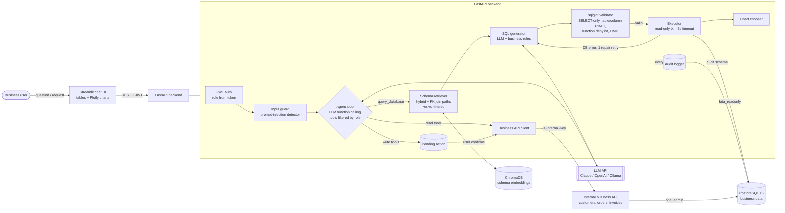
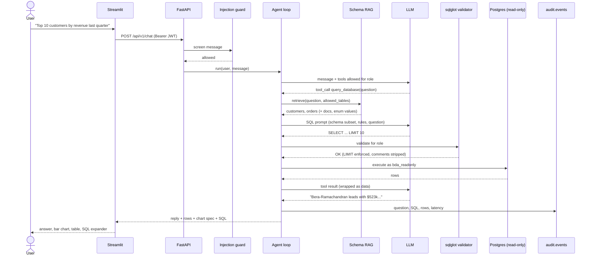
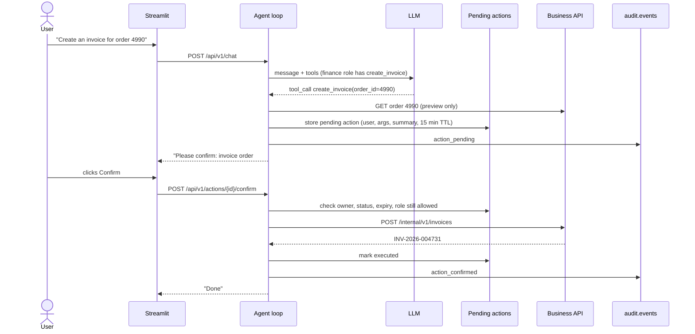
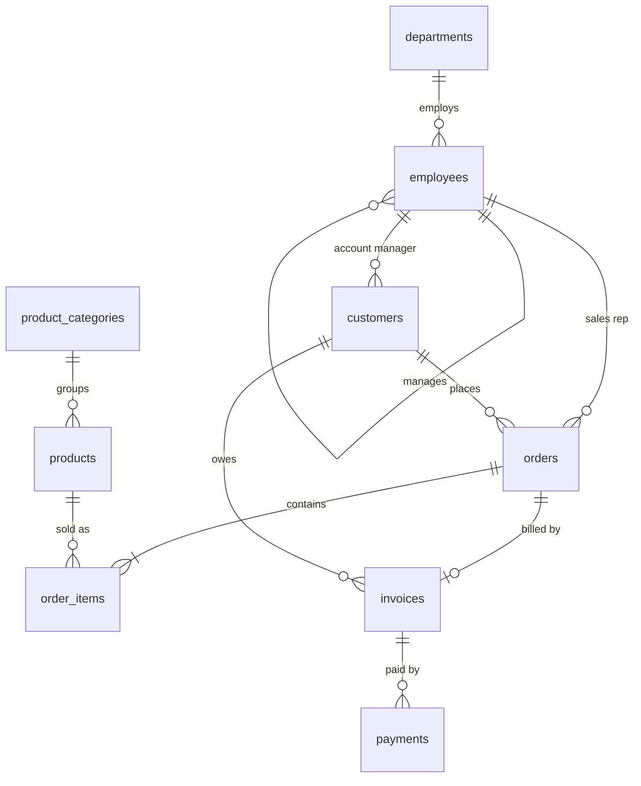

# Architecture

Business Data Assistant lets a non-technical user ask questions ("Top 10 customers by revenue last
quarter") or request actions ("Create an invoice for order 4990") in plain English. Questions are
answered with read-only, validated SQL plus a chart. Actions go through internal REST APIs and only run
after the user confirms. Every step is checked against the user's role and recorded in an audit log.

## System diagram

## Request flow: a data question

## Request flow: an action that changes data

## Components

| Component | Responsibility | Code |
|---|---|---|
| PostgreSQL + seed | Realistic business data; documented schema; least-privilege role | `db/init`, `app/seed` |
| Schema introspection | Tables, columns, comments, PK/FK, enum-like sample values (PII never sampled) | `app/schema_rag/introspect.py` |
| Schema retriever | BM25 + synonyms + ChromaDB embeddings + value hints; FK shortest-path join expansion; RBAC filter | `app/schema_rag/retriever.py` |
| LLM layer | Provider-neutral interface; Claude (tool use, effort, refusal fallbacks), OpenAI-compatible (OpenAI, Ollama), scripted fake for tests | `app/llm/` |
| SQL pipeline | Prompting, SQL extraction, validation, execution, one self-repair retry on DB errors, chart choice, timings | `app/sql/pipeline.py` |
| SQL validator | sqlglot AST rules; rewrites LIMIT; strips comments | `app/sql/validator.py` |
| Executor | `SET TRANSACTION READ ONLY`, per-query `statement_timeout`, JSON-safe rows | `app/sql/executor.py` |
| Agent | Function-calling loop, tool registry with JSON schemas, argument validation, step limit | `app/agent/` |
| Business API | Customers, orders (status state machine), invoices; shared-secret header | `app/business_api/` |
| Security | JWT auth, RBAC policies, injection detector, audit logger | `app/security/` |
| Evaluation | 58 NL questions with gold SQL, 50 attacks, execution-accuracy harness | `backend/eval/` |
| UI | Login per role, chat, SQL disclosure, Plotly charts, CSV, confirm/cancel | `frontend/streamlit_app.py` |

## Key design decisions

**1. Defence in depth for SQL.** No single check is trusted. The prompt states the rules; retrieval hides
what the role can't see; sqlglot validates the parsed tree (not regexes) and rewrites LIMIT; the
database role physically cannot write and has a statement timeout. A blocked query is never "repaired"
into a working one: security failures are final, only genuine database errors get a retry.

**2. Schema RAG instead of the whole schema in every prompt.** Real company databases have hundreds of
tables. Sending only the relevant tables cuts tokens and latency and reduces wrong-table mistakes.
Hybrid retrieval combines embeddings (understands "clients" ≈ customers) with BM25 + a business-synonym
dictionary (explainable, works offline). Enum values found in the data ("Hardware", "overdue") act as
hints. A breadth-first search over foreign keys adds the bridge tables needed for joins, and a small
companion rule adds `orders` whenever `order_items` is used (cancelled orders must be excluded). The
documentation lives in the database as `COMMENT ON`, so it can't drift from the schema.

**3. Custom agent loop vs LangChain / LlamaIndex.**

| | Custom loop (chosen) | LangChain / LlamaIndex |
|---|---|---|
| Control over prompts and guardrails | Full: every tool call passes our RBAC check, argument validation, confirmation gate and audit | Checks must be inserted into framework callbacks; prompts partly hidden |
| Debuggability | Plain Python, ~200 lines | Deep abstraction stacks |
| Dependency churn | Two small SDKs | Frequent breaking API changes |
| Speed to prototype | Slower at first | Very fast |
| Integrations | Write what you need | Hundreds available |

For a security-critical assistant, explicit control and auditability matter more than prototyping
speed. The provider-neutral `LLMClient` interface keeps the option to swap models (Claude, OpenAI, local
Ollama) without touching the loop.

**4. Two database identities.** `bda_admin` owns the schema and is used only by the seeder, the internal
business API and the audit logger. `bda_readonly` is the only identity that ever runs LLM-generated SQL.

**5. Human confirmation for writes, enforced in code.** Tools marked `mutates=True` are never executed
by the loop. The loop stores a pending action with a human-readable preview, bound to the requesting
user, with a 15-minute expiry. Only that user can confirm it, only once, and the role is re-checked at
confirmation time.

**6. Tool results are data, not instructions.** Rows and API responses are wrapped in
`<tool_result_data>` tags and the system prompt tells the model never to follow instructions inside
them (indirect prompt injection via, e.g., a customer named "Ignore previous instructions Inc").

**7. Deterministic seed data and execution-accuracy evaluation.** The same seed always produces the
same rows, and all gold SQL uses dates relative to `now()`, so the 58-question evaluation stays valid
as time passes. Results are compared as result sets (row/column order and extra columns tolerated), the
standard "execution accuracy" metric from Text-to-SQL research (e.g. Spider, BIRD).

## Data model

Audit tables (`audit.events`, `audit.pending_actions`) live in a separate schema the read-only role
cannot access.
